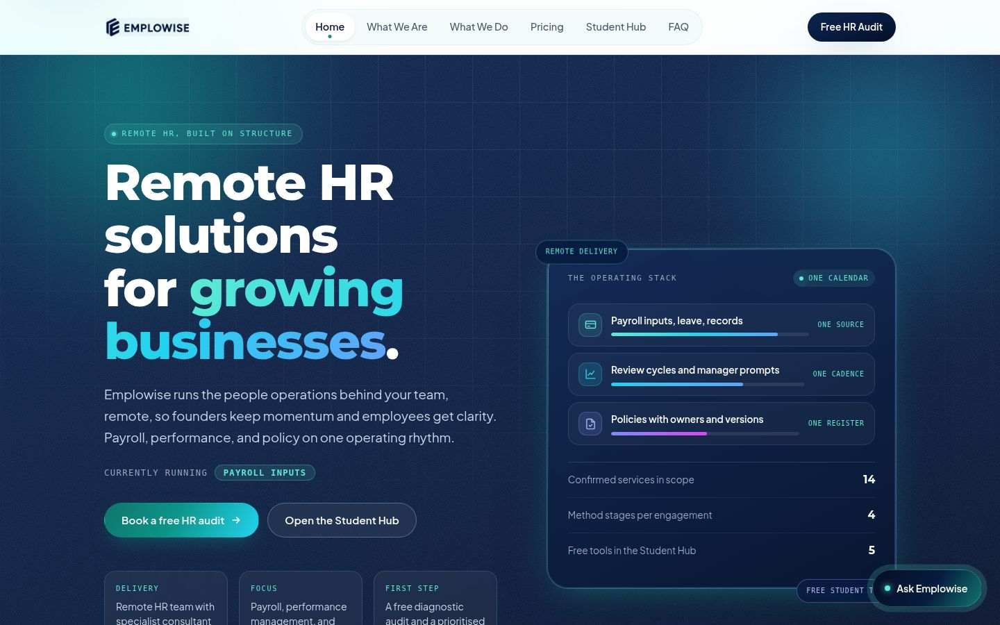
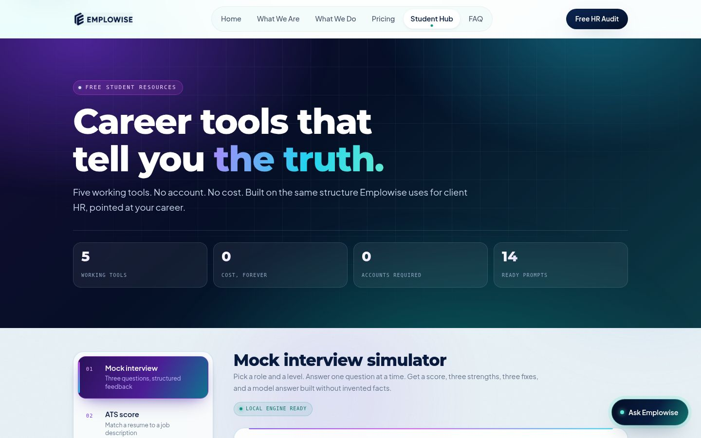
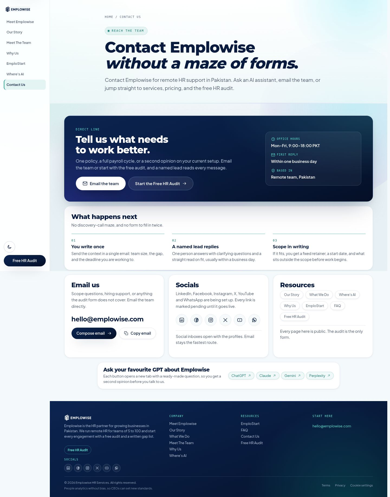
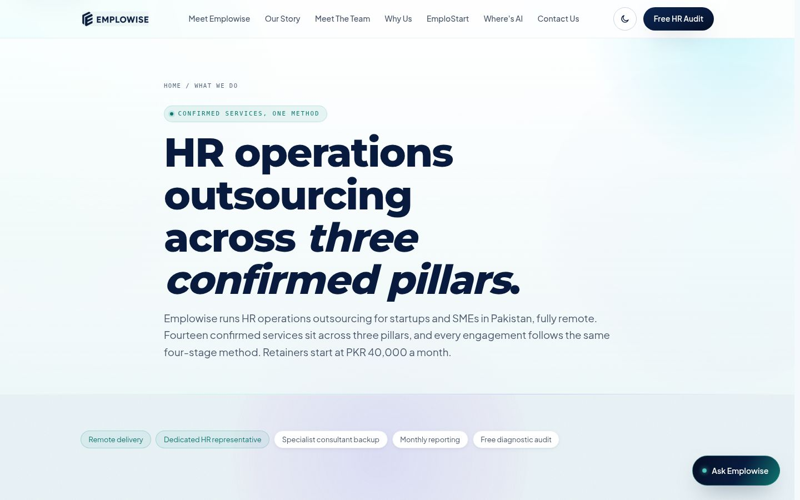
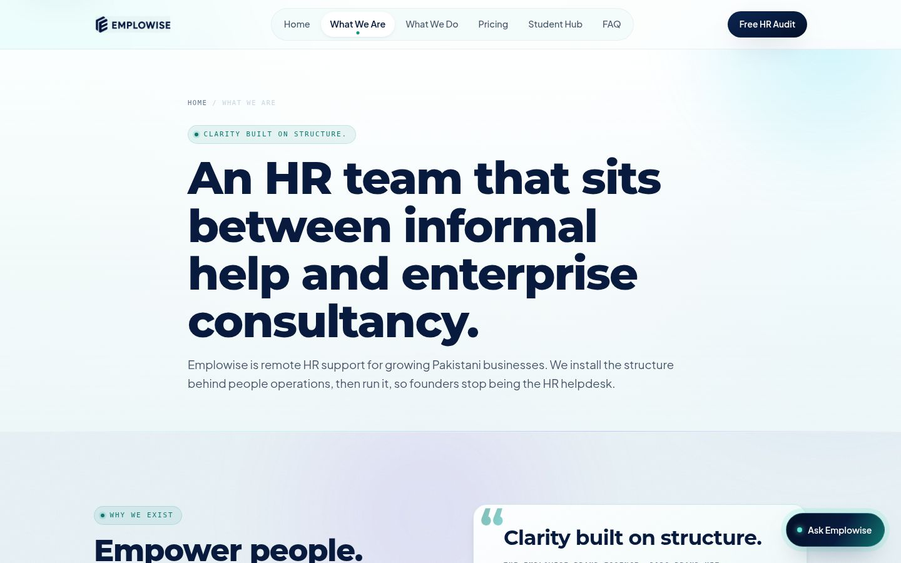
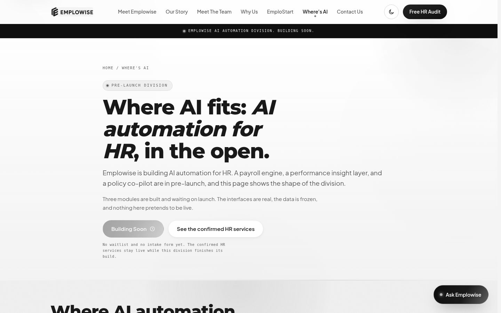
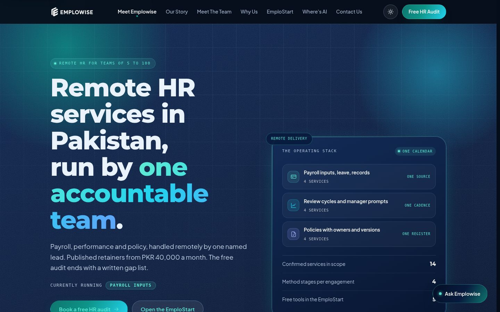
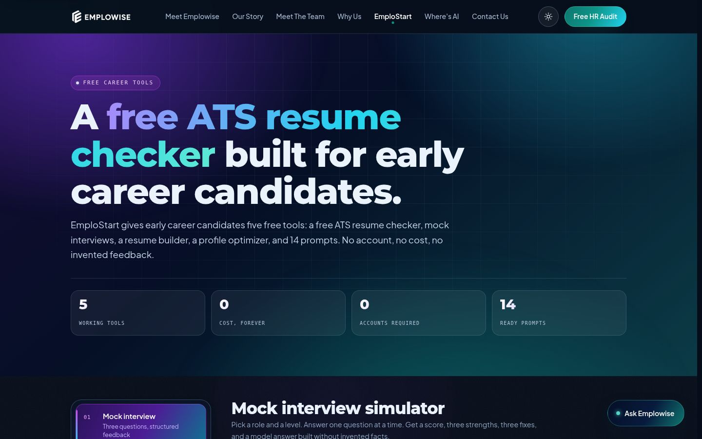
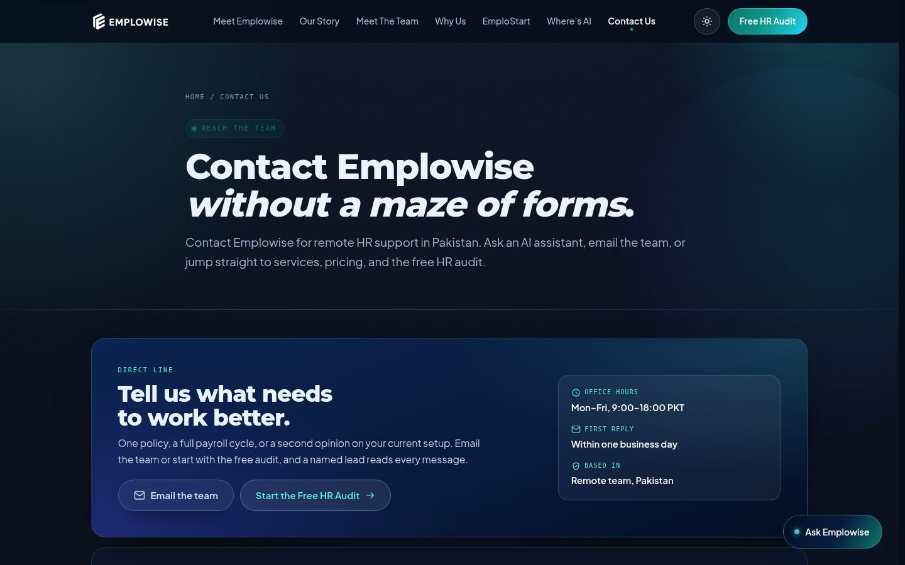
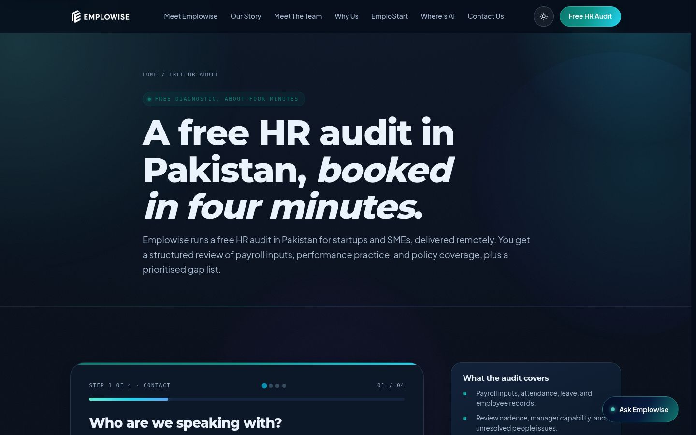

# Emplowise - Live demo - abdul hadi - kodar - cega buildathon

**Remote HR services website, grounded AI assistant and EmploStart, a free career toolkit for early career candidates.**
Laravel 13 · PHP 8.3 · Blade · vanilla JS · SQLite · zero external front-end dependencies.

**Demo:** https://diocese-trees.github.io/Emplowise-Website-Phase-I/ — every page is static HTML on GitHub Pages. The EmploStart scoring runs in the browser from the same engines as the PHP service, and the booking form posts to Web3Forms. `main` is published by `.github/workflows/publish-static.yml`; see [`docs/STATIC_HOSTING.md`](docs/STATIC_HOSTING.md). The work-in-progress copy and its two-way relationship with this repo are described in [`docs/REPO_TOPOLOGY.md`](docs/REPO_TOPOLOGY.md).

[](https://diocese-trees.github.io/Emplowise-Website-Phase-I/)
[](#testing)
[](composer.json)



## Contents

| Area | What ships |
| --- | --- |
| Public site | 11 pages: Meet Emplowise (home), Our Story, What We Do, Where's AI, Why Us, EmploStart, FAQ, Contact Us, Free HR Audit, Terms, Privacy |
| Content model | 14 services, 3 pillars, 4 method stages, 3 packages, 22 FAQs, all copy driven from `config/emplowise.php` |
| AI assistant | 18-intent grounded reply engine, 4–5 line hard cap, optional Qwen model, browser-side knowledge base so it works with no backend |
| EmploStart | 5 free tools: mock interview, ATS score, resume builder, profile optimiser, 14-prompt library |
| Free HR Audit | 4-step validated wizard, honeypot, reference numbers, SQLite persistence |
| Security | Enforced CSP, HSTS with preload on HTTPS, COOP/CORP, nosniff, frame denial, violation reporting |
| Delivery | static export command, GitHub Pages publish workflow, Docker + Nginx + Apache configs, single-file offline demo |

### Screens

Every page ships in light and dark. The pairs below are captured at 1440×900;
the full set (eleven pages × two themes) is in `docs/screenshots/`.

| Why Emplowise | EmploStart |
| --- | --- |
|  |  |

| Free HR Audit | FAQ |
| --- | --- |
|  |  |

| Contact Us | What We Do |
| --- | --- |
|  |  |

| Our Story | What We Are Building |
| --- | --- |
|  |  |

Dark mode:

| Home | EmploStart |
| --- | --- |
|  |  |

| Contact Us | Free HR Audit |
| --- | --- |
|  |  |

## Repository layout

```
app/Http/Controllers     SiteController + API (chat, audit, student, csp report)
app/Services             EmplowiseAssistant, StudentToolkit, AlibabaCloudClient
app/Http/Middleware      SecurityHeaders, ForcePublicUrl
config/emplowise.php     The single source of truth for every public word
resources/views          Layout, 11 pages, chat partial
public/css               13 source stylesheets + 2 generated bundles (site.css, hub.css)
public/js                10 progressive-enhancement scripts (no build step)
database/migrations      audit_requests, chat_messages
tests/Feature            60 tests covering pages, APIs, exports and headers
deploy/                  Dockerfile, nginx, apache, entrypoint
docs/                    hosting, static export, theme/motion, repo topology, screenshots
CHANGELOG.md             dated record of behaviour changes, backfilled from the history
```

---

## About the project

Production-ready Laravel 13 application built for Emplowise HR Services. Nine public pages, a Gen Z–voiced HR assistant, five free career tools, and a multi-step Free HR Audit intake that persists to the database.

All business content lives in `config/emplowise.php`. Nothing commercial is hard-coded in Blade or JavaScript, and claims that lack supplied evidence are left out rather than invented.

---
## Stack

| Layer | Choice |
| --- | --- |
| Framework | Laravel 13.43 |
| PHP | 8.3+ (tested on 8.3.33) |
| Templating | Blade |
| Styling | Modular plain CSS in `public/css` (design tokens, no framework) |
| Client JS | Vanilla ES2017+ in `public/js` (no build step required) |
| Database | SQLite by default (any Laravel-supported driver works) |
| AI | Alibaba Cloud Model Studio via its OpenAI-compatible endpoint |

No Python, Django, Flask, or FastAPI anywhere in the project.

---

## Requirements

- PHP 8.3+ with `pdo_sqlite`, `mbstring`, `openssl`, `curl`, `json`
- Composer 2.x
- Node is **not** required to run the site (assets are served directly from `public/`)

---

## Quick start

```bash
composer install
cp .env.example .env
php artisan key:generate

# Runtime folders (present in the release archive, recreated here for git clones)
mkdir -p storage/framework/{cache/data,sessions,views} storage/logs bootstrap/cache

# SQLite (default). Create the file if it does not exist.
touch database/database.sqlite
php artisan migrate

php artisan serve --host=0.0.0.0 --port=8000
```

Or run the whole sequence with `composer run setup`.

Open `http://localhost:8000`.

If `storage/framework/views` is missing, Laravel answers every page with
`Please provide a valid cache path` — a 500 with no styling. That folder is
required; the steps above and the archive both provide it.

The database is also needed for sessions and cache, because the shipped `.env.example` sets `SESSION_DRIVER=database` and `CACHE_STORE=database`.

---

## Environment variables

```dotenv
APP_NAME="Emplowise"
APP_URL=http://localhost:8000

DB_CONNECTION=sqlite

# Alibaba Cloud Model Studio — OpenAI compatible chat completions
ALIBABA_CLOUD_API_KEY=
ALIBABA_CLOUD_BASE_URL=https://dashscope-intl.aliyuncs.com/compatible-mode/v1
ALIBABA_CLOUD_PRIMARY_MODEL=qwen-max
ALIBABA_CLOUD_FALLBACK_MODEL=kimi

# Optional tuning
ALIBABA_CLOUD_TIMEOUT=45
ALIBABA_CLOUD_CONNECT_TIMEOUT=10
```

If `ALIBABA_CLOUD_API_KEY` is empty the application stays fully functional: every AI endpoint switches to a deterministic local engine (see below). This is intentional so the site can be demoed and tested without credentials or outbound network access.

### AI behaviour and fallback chain

`app/Services/AlibabaCloudClient.php` posts to `{BASE_URL}/chat/completions` using the OpenAI schema.

1. Primary model (`ALIBABA_CLOUD_PRIMARY_MODEL`, default `qwen-max`).
2. On failure (network error, non-2xx, malformed body) the **fallback model** is retried once (`ALIBABA_CLOUD_FALLBACK_MODEL`, default `kimi`).
3. If both fail, or no key is configured, the service returns a deterministic local result. Responses carry `source: "fallback"` and `model: "local-rules"` so the UI and logs can tell the difference.

Local fallbacks are real implementations, not canned strings:

- **Chat** — 18 intents scored by phrase weight with a follow-up prior, near-tie clarification, suggestion chips, and safe links to internal pages; answers built from `config('emplowise.*')`.
- **Interview** — question bank per role family and seniority, STAR-structure scoring, per-dimension score breakdown, a next-practice probe, filler/word-count analysis, model answer.
- **ATS** — keyword extraction with stop-word filtering, synonym and stem matching, weighted score, target-title check, structure and formatting checks, prioritised fixes.
- **Profile optimizer** — optional target role, role derivation, headline variants, summary cleanup, bullet rewriting with action verbs and metric prompts.

---

## Security headers and CSP

All headers are emitted by `app/Http/Middleware/SecurityHeaders.php` and configured in `config/security.php` (no `next.config.js` here; this is Laravel).

```dotenv
SECURITY_CSP_MODE=report_only        # report_only | enforce | off
SECURITY_CSP_REPORT_URI=/api/csp-report
SECURITY_HSTS=true
SECURITY_HSTS_MAX_AGE=63072000
SECURITY_HSTS_INCLUDE_SUBDOMAINS=true
SECURITY_HSTS_PRELOAD=true
```

Enforced policy:

```
default-src 'self'; script-src 'self'; style-src 'self'; img-src 'self' data:;
font-src 'self'; connect-src 'self'; form-action 'self'; frame-ancestors 'none';
base-uri 'self'; object-src 'none'; manifest-src 'self'; report-uri /api/csp-report
```

Supporting changes that made `style-src 'self'` and `font-src 'self'` possible:

- Google Fonts were removed and self-hosted under `public/fonts` (`public/css/fonts.css`), so no third-party origin is needed. Only the latin subset ships; the copy is English only, so the latin-ext faces and their `.woff2` files were dropped.
- The pre-paint theme bootstrap is the single inline script, allowed by a SHA-256 hash in `script-src` (see `App\Support\ThemeBootstrap`); `theme.js` is deferred and only handles toggles and storage.
- The 69 inline `style="..."` attributes in the Blade views were extracted to generated utility classes in `public/css/inline.css`.

### Rollout order

1. `SECURITY_CSP_MODE=report_only`, deploy, browse every page.
2. Watch `storage/logs/laravel.log` for `csp.violation` entries (posted by the browser to `POST /api/csp-report`) and the browser console.
3. When both are silent, set `SECURITY_CSP_MODE=enforce` and reload.
4. `php artisan test --filter=SecurityHeadersTest` guards the behaviour.

### HSTS

`Strict-Transport-Security` is only sent when the request actually arrived over HTTPS, so a plain-HTTP preview cannot pin a browser to HTTPS.

- `max-age=63072000; includeSubDomains; preload` ships by default.
- `preload` never appears without `includeSubDomains`, because browsers ignore the token otherwise.
- Set `SECURITY_HSTS_PRELOAD=false` to drop the token during a staged rollout. Submitting the domain to hstspreload.org is a separate, one-way step: do it only after every subdomain answers over HTTPS, including mail, staging, and old marketing domains.

### Static copies

The Netlify bundle ships a `_headers` file with the same CSP and HSTS values, because static hosting cannot run PHP middleware. Inline styles were removed from the export for the same reason; the preview banner CSS lives in `/css/static-banner.css`.

---

## Styles and assets

There is no Node build step. The layout loads exactly two stylesheets, both
generated by concatenating and minifying the sources in `public/css`:

```bash
php artisan emplowise:bundle-css
```

| Bundle | Loaded by | Sources, in cascade order |
| --- | --- | --- |
| `public/css/site.css` | every page | fonts, tokens, base, layout, components, pages, consent, theme, chat, inline |
| `public/css/hub.css` | `/emplostart` only | student, print |

The manifest is `App\Support\CssBundles::MANIFESTS`. Rules that matter:

- **Edit the sources, never the bundles.** The bundles are checked in because
  the static export ships `public/` as-is; each one starts with a banner naming
  its sources.
- **Regenerate before committing.** Editing `pages.css` alone changes nothing:
  the request still loads the old `site.css`. Run the command and commit both
  the source and regenerated bundle in the same change set.
- **Order is the cascade.** `theme.css` must stay after `components.css` and
  `pages.css` and before `chat.css` and `inline.css`; moving it silently changes
  which dark-mode rule wins.
- Adding a source file means adding it to the manifest, otherwise it is never
  served. `tests/Feature/ExportStaticTest.php` and the SEO audit catch missing
  pages, not missing manifest entries.

Assets are version-stamped by `asset_v()` in `app/Support/helpers.php`, which
appends `?v=<filemtime>` to every `css/`, `js/` and image URL. A regenerated
bundle therefore busts the browser cache without a deploy step. Because the
version is the bundle's own mtime, a bundle that was regenerated *before* the
last source edit is still stale — the cache key only tells the browser the file
changed, not that it matches the sources.

The header logo ships as two `<picture>` elements (navy mark for light, reverse
mark for dark) with 125/250/375px WebP candidates and a PNG fallback; the CSS in
`theme.css` shows one at a time. Images have no build pipeline — derivative sizes
are committed, and the static exporter only rewrites their `srcset` prefixes to
the project base path.

---

## Pages

| Route | Name | View |
| --- | --- | --- |
| `/` | `home` | `pages/home.blade.php` |
| `/what-we-are` | `what-we-are` | `pages/what-we-are.blade.php` |
| `/what-we-do` | `what-we-do` | `pages/what-we-do.blade.php` |
| `/what-we-are-building` | `what-we-are-building` | `pages/what-we-are-building.blade.php` |
| `/why-emplowise` | `why-emplowise` | `pages/why-emplowise.blade.php` |
| `/emplostart` | `emplostart` | `pages/emplostart.blade.php` |
| `/faq` | `faq` | `pages/faq.blade.php` |
| `/contact` | `contact` | `pages/contact.blade.php` |
| `/free-hr-audit` | `free-hr-audit` | `pages/audit.blade.php` |

### EmploStart modules

1. **Mock interview simulator** — role and level selection, one question at a time, structured STAR feedback, per-dimension score breakdown, next-practice probe, score ring, model answer.
2. **ATS resume/JD analyzer** — 0–100 score, keyword match with synonyms and stems, target-title check, structure checklist, formatting checks, prioritised fixes.
3. **ATS resume builder** — single-column form with live preview, repeatable experience/education blocks, browser-only draft autosave and clear, print, `.txt` download, copy as plain text.
4. **Profile optimizer** — optional target role, headline options, summary rewrite, bullet rewrites, quick fixes.
5. **Prompt library** — searchable, category-filtered prompt cards with counts, clear search, copy one, and copy all visible.

The resume builder and prompt library are entirely client-side. Resume drafts autosave to `localStorage` only, with a visible save state and a one-click clear; no draft text is sent to the server. Interview, ATS, and profile call the API when it exists and otherwise run the bundled browser engines in `public/js/toolkit/`, which are ported from `StudentToolkit` and checked against committed PHP fixtures. Answers are not stored in the database, and on the static GitHub Pages build no answer ever leaves the browser.

---

## API

All endpoints sit under the `web` middleware group, so they require the CSRF token exposed in the page `<meta name="csrf-token">` header (the bundled JS sends it as `X-CSRF-TOKEN`).

| Method | Endpoint | Throttle | Purpose |
| --- | --- | --- | --- |
| POST | `/api/chat` | 30/min | HR assistant reply |
| POST | `/api/audit` | 15/min | Store a Free HR Audit request |
| POST | `/api/student/interview/questions` | 20/min | Generate/normalise interview questions |
| POST | `/api/student/interview/feedback` | 20/min | Score one interview answer |
| POST | `/api/student/ats` | 20/min | Score a resume against a job description |
| POST | `/api/student/profile` | 20/min | Optimise headline, summary, bullets |

`POST /api/audit` returns `201` with `message`, `reference` (format `EMP-YYMMDD-XXXX`), `preferred_date`, `preferred_slot`, and `next_step`. Validation failures return `422` with field-level messages the wizard maps back to the offending step. Submissions go to `audit_requests`; a hidden `website` honeypot silently accepts and discards bots with `202`.

Chat transcripts are stored in `chat_messages` (one user row, one assistant row per turn) for follow-up quality review.

---

## Source of truth and zero-hallucination policy

`config/emplowise.php` is the single content source:

| Section | Used by |
| --- | --- |
| `brand`, `mission`, `values`, `positioning` | Home, What We Are |
| `pillars`, `services`, `method`, `outcomes` | Home, What We Do, Pricing |
| `packages`, `pricing_notes`, `legacy_tiers` | Home, Pricing, Audit |
| `faqs` (categories + Q&A) | FAQ page, chat fallback |
| `student_*` (roles, levels, prompts) | Student hub, interview fallback |
| `pending_inputs` | What We Are, Pricing, README |

Rules applied throughout:

- Every confirmed claim traces to the supplied business material.
- No invented prices, clients, testimonials, percentages, or savings.
- Unresolved commercial details stay in `pending_inputs` and shape the assistant's guardrails, so they are never invented.
- The assistant's system prompt includes the same constraint list, so model output is grounded in the same config.

### Open scope register

These items are intentionally unresolved and surfaced in the UI:

1. Package-by-package service inclusions and limits
2. Recruitment fee inclusion vs. separate billing
3. Payroll tax, statutory contribution, and disbursement scope
4. Legal advice qualifications and jurisdiction coverage
5. Dedicated representative allocation (full-time vs. shared)
6. Assessment cadence and industry focus
7. Contract length and notice terms
8. Verified client results, testimonials, and baseline metrics
9. Direct contact phone number and inbox

The Free HR Audit form is the only verified contact channel in this build.

---

## Architecture

```
app/
  Http/Controllers/
    SiteController.php          # renders all eleven pages with config data
    AuditRequestController.php  # validates + persists audit intake
    Api/ChatController.php      # chat endpoint + transcript logging
    Api/StudentController.php   # interview / ATS / profile endpoints
  Models/
    AuditRequest.php
    ChatMessage.php
  Services/
    AlibabaCloudClient.php      # primary → fallback → error
    EmplowiseAssistant.php      # system prompt, intent, local replies
    StudentToolkit.php          # local interview, ATS, profile algorithms
  Console/Commands/
    ExportStatic.php            # renders the public pages to static HTML
config/
  ai.php                        # Alibaba Cloud connection settings
  emplowise.php                 # all business content
  static.php                    # static base URL + Web3Forms key
public/
  css/  12 sources: tokens, base, layout, components, pages, theme,
        consent, chat, student, print, fonts, inline
        plus the generated bundles site.css (loaded by every page) and
        hub.css (loaded only by /emplostart)
  js/   app.js (site + audit wizard), chat.js, student.js, theme.js,
        consent.js, faq.js, home.js, team.js, audit.js
  js/toolkit/  interview.js, ats.js, profile.js (browser ports of StudentToolkit)
resources/views/
  layouts/app.blade.php
  partials/header.blade.php     # site shell: brand, Company dropdown, audit CTA
  partials/footer.blade.php     # site footer, cut verbatim from the layout
  partials/chat.blade.php
  partials/emplostart/          # ats, interview, profile tool panels
  pages/*.blade.php
  errors/404.blade.php          # dynamic 404; the static build mirrors it as 404.html
routes/web.php
tools/parity/                   # PHP-generated fixtures + Node parity harnesses
tests/Feature/                  # page, API, header and static-export tests
.github/workflows/              # publish-static.yml renders and pushes gh-pages
```

Front-end conventions: design tokens in `tokens.css`; teal `#0D9488`, teal-deep `#0F766E`, navy `#081B3E`, aqua `#5EEAD4`, ice `#F0F9F9`, off-white `#F7F7F7`; Montserrat 700/800 for headings, Plus Jakarta Sans 400/500/600 for body. The look is flat with soft navy shadows and teal→aqua gradients reserved for emphasis (hero glow, primary buttons, kickers); every interactive component degrades gracefully without JavaScript. Dark mode, the token contract and the motion timings are documented in [`docs/THEME_AND_MOTION.md`](docs/THEME_AND_MOTION.md).

---

## Testing

```bash
php artisan test
```

Coverage in `tests/Feature/`:

- every public page returns `200`
- pricing renders the confirmed tiers and comparison guardrails
- FAQ renders all four categories
- audit: validation errors, successful persistence, email normalisation, honeypot rejection
- chat: local fallback reply plus two `chat_messages` rows
- interview: deterministic question set and bounded score
- ATS: score range and structural checks
- profile: empty payload rejected, rewrites returned
- static export: eleven pages plus legacy redirects, sub-path assets and canonicals, stripped API config, Web3Forms form swap, no inline styles/scripts

Browser-engine parity is checked separately, outside PHPUnit:

```bash
php tools/parity/generate.php          # regenerate fixtures from the PHP engines
node tools/parity/check-interview.mjs
node tools/parity/check-ats.mjs
node tools/parity/check-profile.mjs
```

---

## Deployment notes

Full instructions for Docker, cPanel shared hosting, and a VPS are in
[`HOSTING.md`](HOSTING.md). Short version:

- Set `APP_ENV=production`, `APP_DEBUG=false`, and a real `APP_KEY`.
- Point `DB_CONNECTION` at MySQL/Postgres if preferred, then run `php artisan migrate --force`.
- Run `php artisan config:cache route:cache view:cache` **after** the environment file is final. Do not cache config while iterating on `.env`.
- The user-facing AI features require outbound HTTPS to the Model Studio endpoint. If egress is blocked, the application still works through local fallbacks.
- Serve `public/` as the document root. Do not expose `.env`, `storage/`, or `vendor/`.
- Assets are emitted root-relative and version-stamped (`/css/base.css?v=<mtime>`), so the site renders correctly behind any proxy, tunnel, or port mapping.

`docker compose up -d --build` builds the production image and serves it on
port 8080 with migrations, config caches, and permissions handled at start-up.

---

## Known limitations

- No authentication or admin UI. Audit submissions and chat transcripts are read directly from the database.
- On the static build the booking form sends through Web3Forms (free tier: 250 submissions a month) instead of the database, so nothing is stored and the reference number is generated in the browser. Set `WEB3FORMS_ACCESS_KEY` before publishing, or the workflow refuses to deploy.
- The AI path was exercised against the local fallback in this environment; supply a key and confirm the primary/fallback chain in staging before launch.
- Client results and package inclusions remain out of scope until the business supplies verified data.
- **Accepted: GitHub Pages cannot send custom HTTP headers.** `X-Frame-Options`, the CSP response header, and the configured HSTS value are emitted by `SecurityHeaders.php` only when PHP serves the page (Docker, Nginx, Apache, Netlify). GitHub Pages serves fixed headers, so the live demo carries GitHub's own `Strict-Transport-Security: max-age=31556952` and no `X-Frame-Options`. A `<meta>` CSP cannot deliver `frame-ancestors`, and `includeSubDomains`/`preload` cannot be asserted for `github.io`. Accepted because the published site has no login, session, or payment flow to clickjack and already runs under one-year HSTS. Closing it for real needs a custom domain behind Cloudflare with a response-header transform rule, or a host that reads a `_headers` file; the Netlify bundle already ships one. Tracked for the production domain.
