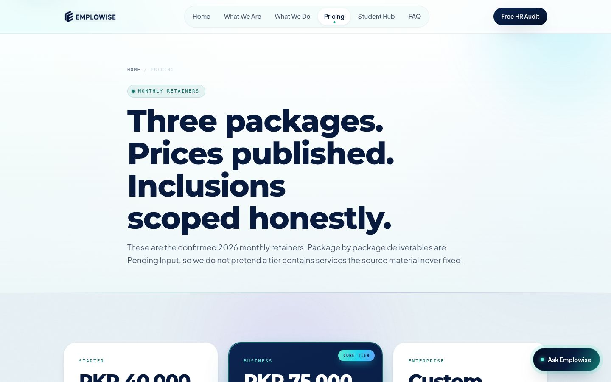
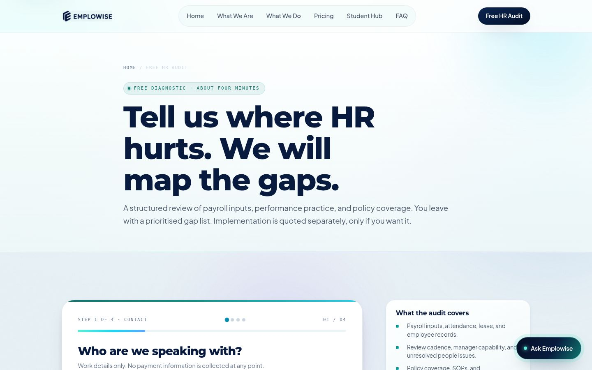
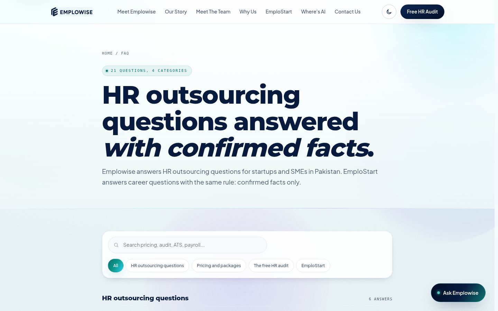

# Emplowise - Live demo - abdul hadi - kodar - cega buildathon

**Remote HR services website, grounded AI assistant and a free student career toolkit.**
Laravel 13 · PHP 8.3 · Blade · vanilla JS · SQLite · zero external front-end dependencies.

**Demo:** https://diocese-trees.github.io/Emplowise-Website-Phase-I/ — static snapshot of all seven pages. The Laravel app adds the audit intake, AI-backed replies and CSP/HSTS headers.

[](https://diocese-trees.github.io/Emplowise-Website-Phase-I/)
[](#testing)
[](composer.json)


## Contents

| Area | What ships |
| --- | --- |
| Public site | 7 pages: Home, What We Are, What We Do, Pricing, Student Hub, FAQ, Free HR Audit |
| Content model | 14 services, 3 pillars, 4 method stages, 3 packages, 22 FAQs, 9 tracked Pending Input items — all from `config/emplowise.php` |
| AI assistant | 18-intent grounded reply engine, 4–5 line hard cap, optional Qwen model, browser-side knowledge base so it works with no backend |
| Student Hub | 5 free tools: mock interview, ATS score, resume builder, profile optimiser, 14-prompt library |
| Free HR Audit | 4-step validated wizard, honeypot, reference numbers, SQLite persistence |
| Security | Enforced CSP, HSTS on HTTPS, COOP/CORP, nosniff, frame denial, violation reporting |
| Delivery | 16 feature tests (102 assertions), Docker + Nginx + Apache configs, static export, single-file offline demo |

### Screens

| Pricing | Student Hub |
| --- | --- |
|  |  |

| Free HR Audit | FAQ |
| --- | --- |
|  |  |

## Repository layout

```
app/Http/Controllers     SiteController + API (chat, audit, student, csp report)
app/Services             EmplowiseAssistant, StudentToolkit, AlibabaCloudClient
app/Http/Middleware      SecurityHeaders, ForcePublicUrl
config/emplowise.php     The single source of truth for every public word
resources/views          Layout, 7 pages, chat partial
public/css|js            Modular CSS (10 files) and vanilla JS (3 files)
database/migrations      audit_requests, chat_messages
tests/Feature            16 tests covering pages, APIs and headers
deploy/                  Dockerfile, nginx, apache, entrypoint
docs/screenshots         README imagery
```

---

## About the project

Production-ready Laravel 13 application built for Emplowise HR Services. Seven public pages, a Gen Z–voiced HR assistant, five free student career tools, and a multi-step Free HR Audit intake that persists to the database.

All business content lives in `config/emplowise.php`. Nothing commercial is hard-coded in Blade or JavaScript, and anything not evidenced by the source material is labelled **Pending Input** rather than invented.

---
## Stack

| Layer | Choice |
| --- | --- |
| Framework | Laravel 13.43 |
| PHP | 8.3+ (tested on 8.3.33) |
| Templating | Blade |
| Styling | Modular plain CSS in `public/css` (design tokens, no framework) |
| Client JS | Vanilla ES2017+ in `public/js` (no build step required) |
| Database | SQLite by default (any Laravel-supported driver works) |
| AI | Alibaba Cloud Model Studio via its OpenAI-compatible endpoint |

No Python, Django, Flask, or FastAPI anywhere in the project.

---

## Requirements

- PHP 8.3+ with `pdo_sqlite`, `mbstring`, `openssl`, `curl`, `json`
- Composer 2.x
- Node is **not** required to run the site (assets are served directly from `public/`)

---

## Quick start

```bash
composer install
cp .env.example .env
php artisan key:generate

# Runtime folders (present in the release archive, recreated here for git clones)
mkdir -p storage/framework/{cache/data,sessions,views} storage/logs bootstrap/cache

# SQLite (default). Create the file if it does not exist.
touch database/database.sqlite
php artisan migrate

php artisan serve --host=0.0.0.0 --port=8000
```

Or run the whole sequence with `composer run setup`.

Open `http://localhost:8000`.

If `storage/framework/views` is missing, Laravel answers every page with
`Please provide a valid cache path` — a 500 with no styling. That folder is
required; the steps above and the archive both provide it.

The database is also needed for sessions and cache, because the shipped `.env.example` sets `SESSION_DRIVER=database` and `CACHE_STORE=database`.

---

## Environment variables

```dotenv
APP_NAME="Emplowise"
APP_URL=http://localhost:8000

DB_CONNECTION=sqlite

# Alibaba Cloud Model Studio — OpenAI compatible chat completions
ALIBABA_CLOUD_API_KEY=
ALIBABA_CLOUD_BASE_URL=https://dashscope-intl.aliyuncs.com/compatible-mode/v1
ALIBABA_CLOUD_PRIMARY_MODEL=qwen-max
ALIBABA_CLOUD_FALLBACK_MODEL=kimi

# Optional tuning
ALIBABA_CLOUD_TIMEOUT=45
ALIBABA_CLOUD_CONNECT_TIMEOUT=10
```

If `ALIBABA_CLOUD_API_KEY` is empty the application stays fully functional: every AI endpoint switches to a deterministic local engine (see below). This is intentional so the site can be demoed and tested without credentials or outbound network access.

### AI behaviour and fallback chain

`app/Services/AlibabaCloudClient.php` posts to `{BASE_URL}/chat/completions` using the OpenAI schema.

1. Primary model (`ALIBABA_CLOUD_PRIMARY_MODEL`, default `qwen-max`).
2. On failure (network error, non-2xx, malformed body) the **fallback model** is retried once (`ALIBABA_CLOUD_FALLBACK_MODEL`, default `kimi`).
3. If both fail, or no key is configured, the service returns a deterministic local result. Responses carry `source: "fallback"` and `model: "local-rules"` so the UI and logs can tell the difference.

Local fallbacks are real implementations, not canned strings:

- **Chat** — intent detection (`pricing`, `services`, `compliance`, `students`, `audit`, `greeting`) plus template answers built from `config('emplowise.*')`.
- **Interview** — question bank per role family and seniority, STAR-structure scoring, filler/word-count analysis, model answer.
- **ATS** — keyword extraction with stop-word filtering, weighted score, structure and formatting checks, prioritised fixes.
- **Profile optimizer** — role derivation, headline variants, summary cleanup, bullet rewriting with action verbs and metric prompts.

---

## Security headers and CSP

All headers are emitted by `app/Http/Middleware/SecurityHeaders.php` and configured in `config/security.php` (no `next.config.js` here; this is Laravel).

```dotenv
SECURITY_CSP_MODE=report_only        # report_only | enforce | off
SECURITY_CSP_REPORT_URI=/api/csp-report
SECURITY_HSTS=true
SECURITY_HSTS_MAX_AGE=63072000
SECURITY_HSTS_INCLUDE_SUBDOMAINS=true
SECURITY_HSTS_PRELOAD=false
```

Enforced policy:

```
default-src 'self'; script-src 'self'; style-src 'self'; img-src 'self' data:;
font-src 'self'; connect-src 'self'; form-action 'self'; frame-ancestors 'none';
base-uri 'self'; object-src 'none'; manifest-src 'self'; report-uri /api/csp-report
```

Supporting changes that made `style-src 'self'` and `font-src 'self'` possible:

- Google Fonts were removed and self-hosted under `public/fonts` (`public/css/fonts.css`), so no third-party origin is needed.
- The 69 inline `style="..."` attributes in the Blade views were extracted to generated utility classes in `public/css/inline.css`.

### Rollout order

1. `SECURITY_CSP_MODE=report_only`, deploy, browse every page.
2. Watch `storage/logs/laravel.log` for `csp.violation` entries (posted by the browser to `POST /api/csp-report`) and the browser console.
3. When both are silent, set `SECURITY_CSP_MODE=enforce` and reload.
4. `php artisan test --filter=SecurityHeadersTest` guards the behaviour.

### HSTS

`Strict-Transport-Security` is only sent when the request actually arrived over HTTPS, so a plain-HTTP preview cannot pin a browser to HTTPS.

- `max-age=63072000; includeSubDomains` ships by default.
- `preload` stays off until every subdomain is HTTPS and you control the domain permanently. Then set `SECURITY_HSTS_PRELOAD=true` and submit to hstspreload.org. It is a one-way door.

### Static copies

The Netlify bundle ships a `_headers` file with the same CSP and HSTS values, because static hosting cannot run PHP middleware. Inline styles were removed from the export for the same reason; the preview banner CSS lives in `/css/static-banner.css`.

---

## Pages

| Route | Name | View |
| --- | --- | --- |
| `/` | `home` | `pages/home.blade.php` |
| `/what-we-are` | `what-we-are` | `pages/what-we-are.blade.php` |
| `/what-we-do` | `what-we-do` | `pages/what-we-do.blade.php` |
| `/pricing` | `pricing` | `pages/pricing.blade.php` |
| `/student-hub` | `student-hub` | `pages/student-hub.blade.php` |
| `/faq` | `faq` | `pages/faq.blade.php` |
| `/free-hr-audit` | `free-hr-audit` | `pages/audit.blade.php` |

### Student hub modules

1. **Mock interview simulator** — role and level selection, one question at a time, structured STAR feedback, score ring, model answer.
2. **ATS resume/JD analyzer** — 0–100 score, keyword match, structure checklist, formatting checks, prioritised fixes.
3. **ATS resume builder** — single-column form with live preview, repeatable experience/education blocks, print, `.txt` download, copy as plain text.
4. **Profile optimizer** — headline options, summary rewrite, bullet rewrites, quick fixes.
5. **Prompt library** — searchable, category-filtered, copy-to-clipboard prompt cards.

The resume builder and prompt library are entirely client-side. Interview, ATS, and profile call the API and fall back locally.

---

## API

All endpoints sit under the `web` middleware group, so they require the CSRF token exposed in the page `<meta name="csrf-token">` header (the bundled JS sends it as `X-CSRF-TOKEN`).

| Method | Endpoint | Throttle | Purpose |
| --- | --- | --- | --- |
| POST | `/api/chat` | 30/min | HR assistant reply |
| POST | `/api/audit` | 15/min | Store a Free HR Audit request |
| POST | `/api/student/interview/questions` | 20/min | Generate/normalise interview questions |
| POST | `/api/student/interview/feedback` | 20/min | Score one interview answer |
| POST | `/api/student/ats` | 20/min | Score a resume against a job description |
| POST | `/api/student/profile` | 20/min | Optimise headline, summary, bullets |

`POST /api/audit` returns `201` with `message`, `reference` (format `EMP-YYMMDD-XXXX`), `preferred_date`, `preferred_slot`, and `next_step`. Validation failures return `422` with field-level messages the wizard maps back to the offending step. Submissions go to `audit_requests`; a hidden `website` honeypot silently accepts and discards bots with `202`.

Chat transcripts are stored in `chat_messages` (one user row, one assistant row per turn) for follow-up quality review.

---

## Source of truth and zero-hallucination policy

`config/emplowise.php` is the single content source:

| Section | Used by |
| --- | --- |
| `brand`, `mission`, `values`, `positioning` | Home, What We Are |
| `pillars`, `services`, `method`, `outcomes` | Home, What We Do, Pricing |
| `packages`, `pricing_notes`, `legacy_tiers` | Home, Pricing, Audit |
| `faqs` (categories + Q&A) | FAQ page, chat fallback |
| `student_*` (roles, levels, prompts) | Student hub, interview fallback |
| `pending_inputs` | What We Are, Pricing, README |

Rules applied throughout:

- Every confirmed claim traces to the supplied business material.
- No invented prices, clients, testimonials, percentages, or savings.
- Unresolved commercial details render as **Pending Input** in the UI, not as silent omissions.
- The assistant's system prompt includes the same constraint list, so model output is grounded in the same config.

### Pending Input register

These items are intentionally unresolved and surfaced in the UI:

1. Package-by-package service inclusions and limits
2. Recruitment fee inclusion vs. separate billing
3. Payroll tax, statutory contribution, and disbursement scope
4. Legal advice qualifications and jurisdiction coverage
5. Dedicated representative allocation (full-time vs. shared)
6. Assessment cadence and industry focus
7. Contract length and notice terms
8. Verified client results, testimonials, and baseline metrics
9. Direct contact phone number and inbox

The Free HR Audit form is the only verified contact channel in this build.

---

## Architecture

```
app/
  Http/Controllers/
    SiteController.php          # renders all seven pages with config data
    AuditRequestController.php  # validates + persists audit intake
    Api/ChatController.php      # chat endpoint + transcript logging
    Api/StudentController.php   # interview / ATS / profile endpoints
  Models/
    AuditRequest.php
    ChatMessage.php
  Services/
    AlibabaCloudClient.php      # primary → fallback → error
    EmplowiseAssistant.php      # system prompt, intent, local replies
    StudentToolkit.php          # local interview, ATS, profile algorithms
config/
  ai.php                        # Alibaba Cloud connection settings
  emplowise.php                 # all business content
public/
  css/  tokens, base, layout, components, pages, chat, student, print
  js/   app.js (site + audit wizard), chat.js, student.js
resources/views/
  layouts/app.blade.php
  partials/chat.blade.php
  pages/*.blade.php
routes/web.php
tests/Feature/SiteAndApiTest.php
```

Front-end conventions: design tokens in `tokens.css`; teal `#0D9488`, teal-deep `#0F766E`, navy `#081B3E`, aqua `#5EEAD4`, ice `#F0F9F9`, off-white `#F7F7F7`; Montserrat 700/800 for headings, Plus Jakarta Sans 400/500/600 for body; flat geometry, no gradients or drop shadows. All interactive components degrade gracefully without JavaScript.

---

## Testing

```bash
php artisan test
```

Coverage in `tests/Feature/SiteAndApiTest.php`:

- every public page returns `200`
- pricing shows Pending Input guardrails and the correct confirmed tiers
- FAQ renders all four categories
- audit: validation errors, successful persistence, email normalisation, honeypot rejection
- chat: local fallback reply plus two `chat_messages` rows
- interview: deterministic question set and bounded score
- ATS: score range and structural checks
- profile: empty payload rejected, rewrites returned

---

## Deployment notes

Full instructions for Docker, cPanel shared hosting, and a VPS are in
[`HOSTING.md`](HOSTING.md). Short version:

- Set `APP_ENV=production`, `APP_DEBUG=false`, and a real `APP_KEY`.
- Point `DB_CONNECTION` at MySQL/Postgres if preferred, then run `php artisan migrate --force`.
- Run `php artisan config:cache route:cache view:cache` **after** the environment file is final. Do not cache config while iterating on `.env`.
- The user-facing AI features require outbound HTTPS to the Model Studio endpoint. If egress is blocked, the application still works through local fallbacks.
- Serve `public/` as the document root. Do not expose `.env`, `storage/`, or `vendor/`.
- Assets are emitted root-relative and version-stamped (`/css/base.css?v=<mtime>`), so the site renders correctly behind any proxy, tunnel, or port mapping.

`docker compose up -d --build` builds the production image and serves it on
port 8080 with migrations, config caches, and permissions handled at start-up.

---

## Known limitations

- No authentication or admin UI. Audit submissions and chat transcripts are read directly from the database.
- No email delivery: the audit reference is displayed on screen. Wire a notification job if email confirmation is required.
- The AI path was exercised against the local fallback in this environment; supply a key and confirm the primary/fallback chain in staging before launch.
- Client results and package inclusions stay Pending Input until the business supplies verified data.
